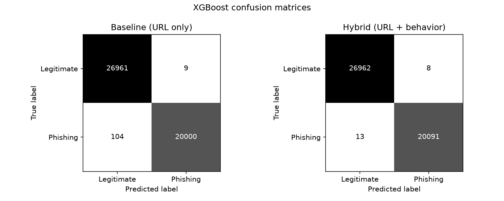
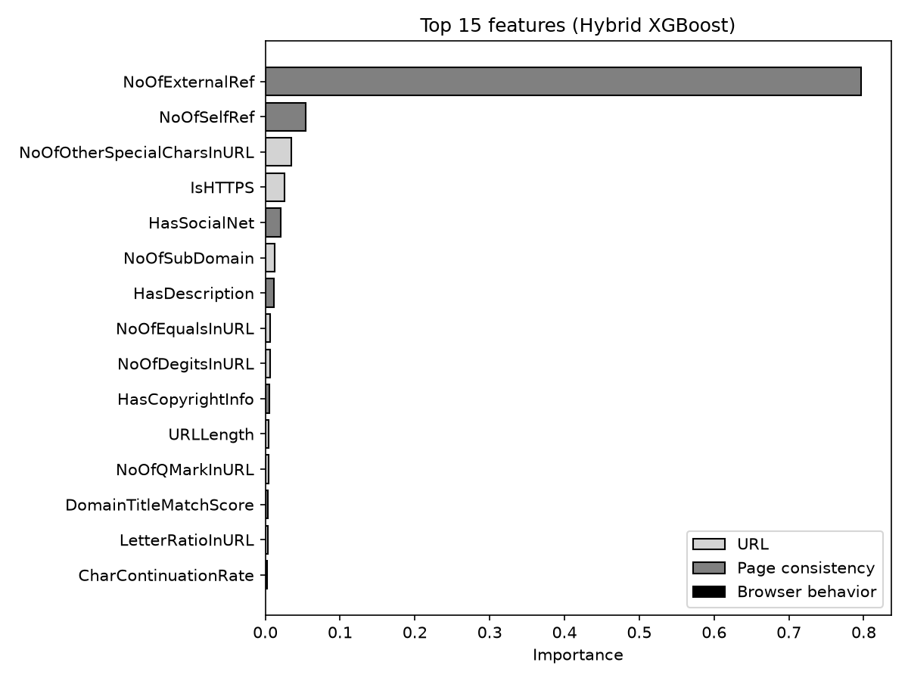
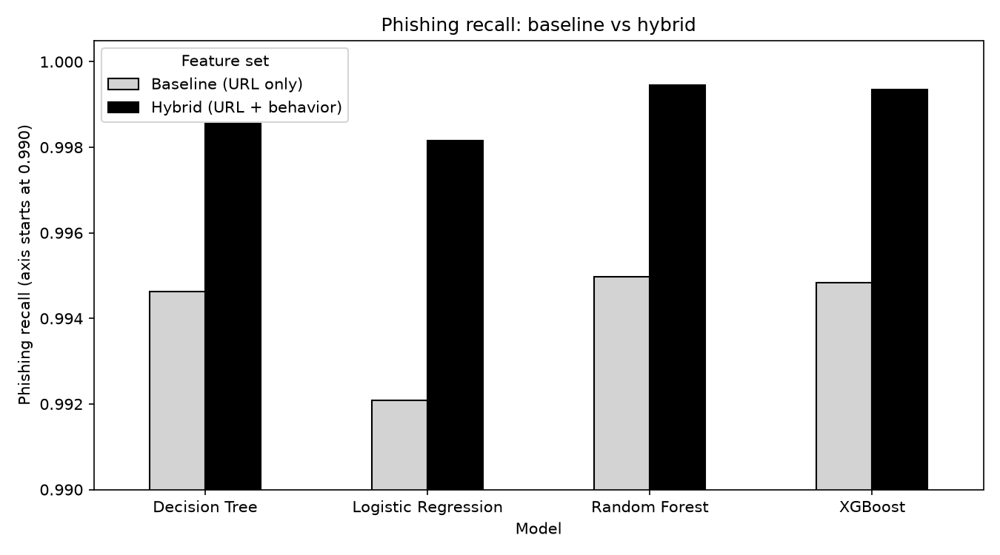

# A Lightweight AI-Based Phishing Detection System Using Browser Behavior Analysis

Does adding page-consistency and browser-related features to URL features improve phishing detection? This project tests that with a baseline model (URL features only) and a hybrid model, then runs an ablation to see which feature group actually helps.

## Dataset

PhiUSIIL Phishing URL Dataset (UCI Machine Learning Repository): 235,795 URLs, of which 235,370 remain after removing 425 duplicate URLs. The dataset is not included in this repository because of its size.

## Method

- Features were split into three groups: URL (19), page consistency (10) and browser behavior (8).
- Three columns (URLSimilarityIndex, TLDLegitimateProb, URLCharProb) were excluded because they are computed from other URLs in the dataset and could inflate results.
- Models: Logistic Regression, Decision Tree, Random Forest, XGBoost.
- Evaluation: 80/20 stratified split (47,074 test URLs), phishing as the positive class.

## Results

XGBoost, baseline vs hybrid:

| Feature set | Accuracy | Precision | Recall | F1 | Missed phishing |
|---|---|---|---|---|---|
| Baseline (URL only, 19 features) | 0.9976 | 0.9996 | 0.9948 | 0.9972 | 104 |
| Hybrid (all 37 features) | 0.9996 | 0.9996 | 0.9994 | 0.9995 | 13 |

The hybrid model reduced missed phishing URLs from 104 to 13 (about 87% fewer) out of roughly 20,100 phishing URLs in the test set. All four models improved with the hybrid feature set. Full results are in `results/model_results.csv`.

### Ablation (XGBoost)

| Feature set | Features | Missed phishing | False alarms |
|---|---|---|---|
| URL only | 19 | 104 | 9 |
| URL + page consistency | 29 | 14 | 8 |
| URL + browser behavior | 27 | 106 | 13 |
| URL + consistency + behavior | 37 | 13 | 8 |

Almost all of the improvement comes from the page-consistency features (for example, the number of external references). The browser-behavior features alone gave no improvement over URL-only features and added one extra catch on top of the consistency features.

### Charts

## Limitations

- The "browser behavior" columns in PhiUSIIL are extracted from static page HTML, not recorded from a live browser session.
- The URL-only baseline is already very strong (about 99.7% accuracy), so the room for improvement is small.
- Results come from a single dataset snapshot and have not been tested on an independent dataset.

## Future scope

- A Selenium module that records real browser behavior (redirect chains, popups, form actions).
- A browser extension that warns users in real time.
- Testing on a second dataset.
- Multilingual phishing detection.

## Project structure

    data/          dataset files (not tracked)
    notebooks/     phishing_analysis.ipynb (results walkthrough)
    src/           scripts for cleaning, features, training, charts, ablation
    results/       result tables and charts
    models/        saved XGBoost models

## How to run

1. Download the PhiUSIIL dataset from UCI and save it as `data/phiusiil.csv`.
2. Create and activate a virtual environment, then install the libraries:

        python -m venv venv
        venv\Scripts\activate
        pip install -r requirements.txt

3. Run the scripts in this order:

        python src\clean_data.py
        python src\train_models.py
        python src\make_charts.py
        python src\ablation.py

4. Open `notebooks/phishing_analysis.ipynb` to see the results.